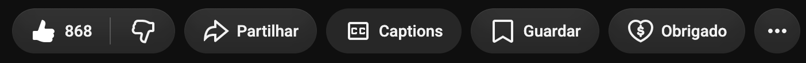
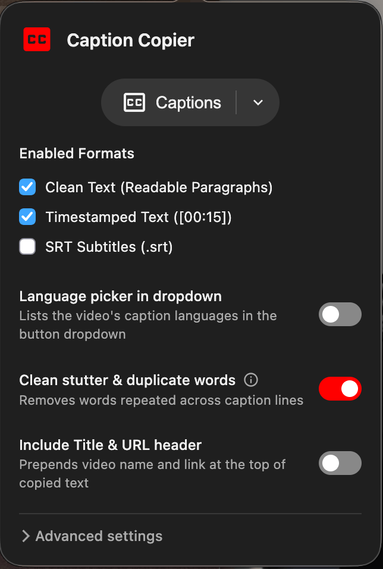

# YouTube Caption Copier

Button to copy the active YouTube video captions to the clipboard.

  

 

## Screenshots

The **Captions** button sits next to YouTube's own action buttons:

Settings popup:

